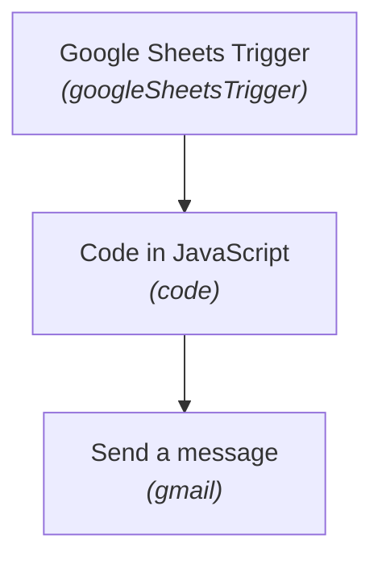

# ⚡ Automated Data Cleaning & Sanitation Pipeline

[](https://n8n.io)
[](#)
[](#)
[](#)

> **Workflow Sequence #08** in the [Maheen Azhar n8n Workflow Collection](https://github.com/maheenazhar/n8n-workflows-collection).


> 📊 **In-Depth Technical Report:** For detailed node configurations, runtime mechanics, security audits, and failure mode analysis, read the **[Comprehensive Technical & Operational Report](REPORT.md)**.

---

## 📖 Overview

Ingests raw spreadsheet rows, executes automated sanitization routines (whitespace trimming, date standardization, email format verification, anomaly quarantine), and dispatches clean record notifications.

### 🎯 Key Use Case
Cleaning incoming lead lists, survey submissions, and customer registrations before entering CRM databases.

---

## 🏗️ Architecture & Flow



---

## 🧩 Nodes in this Workflow

| # | Node Name | Type | Version |
|---|-----------|------|---------|
| 1 | **Google Sheets Trigger** | `n8n-nodes-base.googleSheetsTrigger` | v1 |
| 2 | **Code in JavaScript** | `n8n-nodes-base.code` | v2 |
| 3 | **Send a message** | `n8n-nodes-base.gmail` | v2.2 |

---

## 🔑 Prerequisites & Credentials

Before running this workflow, ensure you have the following configured in your n8n environment:

- [ ] **Google Sheets credential**
- [ ] **Gmail credential**
- [ ] **Google Sheet with unformatted/raw input rows**

> [!NOTE]
> All credentials are decoupled from this export file for security. When importing into your n8n workspace, re-assign your local credentials in the respective node configuration panels.

---

## 🚀 Setup & Installation

1. **Clone or Download:**
   ```bash
   git clone https://github.com/maheenazhar/n8n-08-data-cleaning.git
   cd n8n-08-data-cleaning
   ```
2. **Import into n8n:**
   - Open your n8n canvas.
   - Click the top-right menu `...` -> **Import from File**.
   - Select `workflow.json` from this repository.
   - *(Alternative)*: Open `workflow.json`, copy the entire JSON contents, and paste directly (`Ctrl+V`) onto the n8n canvas.
3. **Configure Credentials:**
   - Open each integration node marked with a red credential prompt.
   - Select or configure your accounts (e.g., Google OAuth, Groq API, Supabase, SMTP).
4. **Activate / Test:**
   - Click **Test step** or **Execute Workflow** to verify end-to-end functionality.
   - Toggle the workflow to **Active** for live production use.

---

## 📄 File Structure

```
08-data-cleaning/
├── workflow.json   # Full exportable n8n workflow definition
├── README.md       # Comprehensive documentation and architecture
└── .gitignore      # Standard Git exclusions
```

---

## 👤 Author & Repository

- **Author:** [Maheen Azhar](https://github.com/maheenazhar)
- **Workflow ID:** `omFNUc30mUXxdZf2`
- **Created Date:** `2026-10-08 06:44:12.322`
- **Last Modified:** `2026-10-08 07:28:49.010`
- **Repository:** [`https://github.com/maheenazhar/n8n-08-data-cleaning`](https://github.com/maheenazhar/n8n-08-data-cleaning)

---

*Part of the [n8n Workflows Collection](https://github.com/maheenazhar/n8n-workflows-collection) by Maheen Azhar.*
